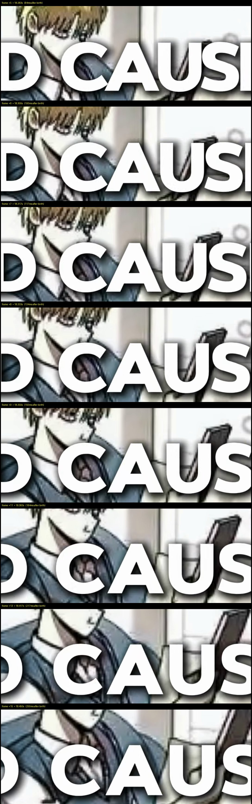

## How to update
- `git pull origin main`
- Shorts rendered BEFORE 2026-10-28 keep the old caption look (they were
  already posted). To renew one locally, purge stale segments and re-render:
  `rm videos/<slug>/shorts/<short>/clips/*.mp4` then
  `py tools/assemble_shorts.py --slug <slug> --short <short> --series-title "SERIES NAME"`.

## 🔍 Research 🔍

* Akiel Runes reference study — the channel the style copies from
  (@AkielRunes, 98.1k-sub manhwa shorts): 2 shorts downloaded with yt-dlp
  (one at 4K/60fps), caption transitions watched frame by frame at 2–2.5×
  zoom — the style is too quick to see at speed.
* Reference anatomy captured: ONE line (2 centered lines when long)
  dead-center, ALL CAPS, white, thin ~3px black stroke, soft dark shadow,
  rounded-corner chunky bold sans, wide settled letter gaps.
* Signature entrance captured: text never moves — blocks are born clumped
  (~90% of settled width) and their letter gaps expand outward over ~8 frames
  (~130ms), settling with visible easing, then holding dead still.
* Frame-by-frame-only details captured: blocks pop in at near-full opacity
  (no dim ramp), and settled lines carry a barely visible vibration.

## 🎬 Shorts renderer 🎬 (`tools/assemble_shorts.py`)
### Added

* Per-frame ASS caption events — `build_ass` now emits one `Dialogue` line
  per video frame at a fixed dead-center `\pos` anchor (~1.2k events per
  44s short), so all caption motion is computed in Python.
* `blockify()` — uppercase narration split into one-line blocks by
  PIL-measured Rubik widths at *settled* tracking (budget = 1080 − 2×40px);
  prefers sentence ends, then commas, then greedy splits; safety pass
  guarantees a block never wraps (loud warning if one ever would).
* `fsp_pair()` + `pop_gap_frac()` — the spring birth: fsp clumped at −10%
  width, ease-out rise overshooting to 1.12× the gap delta, sine settle back,
  ~290ms total. Verified from the rendered ASS: −6.1 → 7.64 (peak) → 6.17
  settled — never a hard stop.
* `jitter_xy()` — continuous ~1px dual-sine vibration per axis at 8–13Hz on
  the `\pos` anchor; mean position never drifts; deterministic per block so
  re-renders are identical.
* `speech_spans()` restored — faster-whisper is back but ONLY for
  block-boundary anchoring: when the token count matches the script, each
  block's birth = the real spoken onset of its first word ("as soon as the
  TTS says it"); on mismatch, blocks spread proportionally across the REAL
  speech window (7 of 8 sample entries took exact onsets).
* `split_frames()` — frame-exact segment allocation: an entry's video length
  now always equals its mp3 duration (Bresenham split across its beats,
  `-frames:v` pinned per segment).
* SNAP-in opacity — frame-0 alpha ~62%, full by the next frame (matches the
  reference blocks, which pop in at full strength).

### Changed

* Caption font Arial Black → **Rubik Bold** (rounded bold sans — the CapCut
  caption look, already installed on the machine; Arial Black kept as
  fallback), same 96px size (67px cap height preserved).
* Narration rendered ALL CAPS (chunking measures the uppercased widths).
* Outline 7px → **3px** + soft blurred drop shadow — the thin-border look.
* Segment rendering: each beat independently rounded to frames → frame-exact
  allocation above.
* Remove the per-word karaoke system (`\k` tags, `keyword_of()`, the yellow
  keyword highlight) — obsolete under block-level captions.
* Remove the `CAP_TOP` top-third caption anchor and multi-line card wrapping
  — every block is one measured line at dead center.
* Remove faster-whisper as a caption *timing* device in proportion-arithmetic
  mode — it now anchors block births to measured speech instead.

### Fixed

* Cumulative A/V rounding drift (up to ~0.2s by the end of a short) that made
  captions trail the narration late in the video.
* Sync misses where captions appeared while the voice had not reached them —
  births now ride real word onsets.
* The expand-hard-stop feel (user note) → decelerating spring settle.
* The stillness of settled lines (user note) → subtle continuous vibration.

## 📚 Documentation 📚
### Changed

* `research/shorts_style_notes.md` caption spec → the 2026-10-28 house
  caption style (spring pop, vibration, speech-anchored block timing) with
  the full 60fps-measured reference findings.
* `AGENTS.md` — renderer bullet and captions gotcha rewritten to the new
  behavior, including the purge rule (timing changes invalidate clips).
* `changelog/` — restructured to these per-line release folders
  (`docs/changelogs` style from pokeemerald-expansion).

## 🧶 Bundled media 🧶

*  — entrance + settled states,
  reference vs ours.
*  — Akiel's block
  birth magnified (clumped → expanding → settle).
*  — our 30fps birth strip (clumped,
  easing wide, settling).
*  — settled frames at 2.5×
  zoom; look for the hair-width drift.

**Full Changelog**: https://github.com/zeenify/manhwa-recap-automation/compare/31fc53e...2a882d8

<!--Last commit: 2a882d8-->
