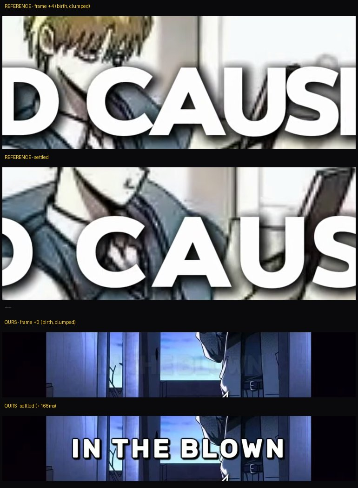
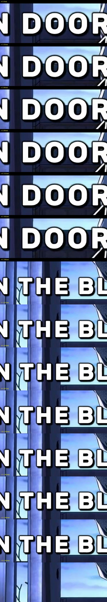

# Shorts captions rebuild (one-line center blocks, Akiel-Runes style)

**Date:** 2026-10-28
**Bundle:** v1
**Scope:** `tools/assemble_shorts.py` caption engine, shorts caption house
style. Scripts, TTS, beat assets, and the long-form pipeline untouched.
**Commits:** [c9547cc](https://github.com/zeenify/manhwa-recap-automation/commit/c9547cc)
one update with three same-day commits, each a full working state:
[70d1c86](https://github.com/zeenify/manhwa-recap-automation/commit/70d1c86)
step 1 — the style copied (block captions, Rubik, center, snap-in) →
[2a882d8](https://github.com/zeenify/manhwa-recap-automation/commit/2a882d8)
step 2 — motion + sync (spring pop, vibration, whisper-anchored births,
frame-exact segments) → (later additions land as new numbered updates).

## 🔍 Research 🔍

### Added

* Akiel Runes reference study — located the channel the user pointed at
  (@AkielRunes, 98.1k-sub manhwa shorts), downloaded 2 shorts with yt-dlp
  (one at 4K/60fps), watched caption transitions frame by frame at 2–2.5×
  zoom to nail a style too quick to see at speed.
* Captured the reference anatomy: ONE line (2 centered lines when long)
  dead-center, ALL CAPS, white, thin ~3px black stroke, soft dark shadow,
  rounded-corner chunky bold sans, wide settled letter gaps.
* Captured the signature entrance: text never moves — blocks are born
  clumped (~90% of settled width) and their letter gaps expand outward over
  ~8 frames (~130ms), settling with visible easing, then holding dead still.
* Captured the two subtleties only measurable frame by frame: blocks pop in
  at near-full opacity (no dim ramp), and settled lines carry a barely
  visible vibration.

## 🎬 Caption engine 🎬 (`tools/assemble_shorts.py`)

### Added

* Per-frame ASS caption events — `build_ass` now emits one `Dialogue` line
  per video frame at a fixed dead-center `\pos` anchor (~1.2k events for a
  44s short), so all caption motion is computed in Python.
* `blockify()` — uppercase narration split into one-line blocks by
  PIL-measured Rubik widths at *settled* tracking (budget = 1080 − 2×40px);
  prefers sentence ends, then commas, then greedy splits; safety pass
  guarantees a block never wraps (loud warning if one ever would).
* `fsp_pair()` + `pop_gap_frac()` — the spring birth: fsp clumped at −10%
  width, ease-out rise overshooting to 1.12× the gap delta, sine settle back,
  ~290ms total. Verified from the rendered ASS: −6.1 → 7.64 (peak) → 6.17
  settled — never a hard stop.
* `jitter_xy()` — continuous ~1px dual-sine vibration per axis at 8–13Hz on
  the `\pos` anchor; mean position never drifts; deterministic per block so
  re-renders are identical.
* `speech_spans()` restored — faster-whisper is back but ONLY for
  block-boundary anchoring: when token count matches the script, each block's
  birth = the real spoken onset of its first word (sync: "as soon as the TTS
  says it"); on mismatch, blocks spread proportionally across the REAL
  speech window (7 of 8 sample entries took exact onsets).
* `split_frames()` — frame-exact segment allocation: an entry's video length
  now always equals its mp3 duration (Bresenham split across its beats,
  `-frames:v` pinned per segment).
* SNAP-in opacity — frame-0 alpha ~62%, full by the next frame (matches the
  reference's instant pop).

### Changed

* Caption font Arial Black → **Rubik Bold** (rounded bold sans — the CapCut
  caption look, already installed on the machine; Arial Black kept as
  fallback), same 96px size (67px cap height preserved).
* Narration rendered ALL CAPS (chunking measures the uppercased widths).
* Outline 7px → **3px** + soft blurred drop shadow — the thin-border look.
* Segment rendering: each beat independently rounded to frames → frame-exact
  allocation above; clips must be purged when timing code changes (docs
  updated to say so).

### Removed

* Per-word karaoke: `\k` tags, `keyword_of()` and the yellow keyword
  highlight (they died with word-level timing; no longer needed for the
  block style).
* The `CAP_TOP` top-third caption anchor and multi-line card wrapping —
  every block is one measured line at dead center for the whole short.
* faster-whisper as a caption *timing* device in proportion-arithmetic mode —
  it now anchors block births to measured speech instead.

### Fixed

* Cumulative A/V rounding drift (up to ~0.2s by the end of a short) that made
  captions trail the narration late in the video.
* Sync misses where captions appeared while the voice had not reached them —
  births now ride real word onsets.
* The expand-hard-stop feel (user note) → decelerating spring settle.
* The stillness of settled lines (user note) → subtle continuous vibration.

## 📜 House docs 📜

### Changed

* `research/shorts_style_notes.md` caption spec → the house caption style (spacing
  pop with spring settle, vibration, speech-anchored block timing) with the
  full 60fps-measured reference findings.
* `AGENTS.md` — renderer bullet and captions gotcha rewritten to the v4
  behavior, including the purge rule change (timing changes invalidate clips).
* `changelog/` — `updates/` renamed (clearer term) and folderized: one
  folder per update + `README.md` index, pokeemerald-expansion format.

## 🧪 Verification 🧪

* Sample re-render of `001_door_kick` — 1080×1920/30fps, 43.9s, ffprobe
  clean, idempotent (purged stale clips first).
* Pop curve read from the generated ASS: clumped birth, 1.12× overshoot,
  settle; `\pos` oscillates ±1px around center on settled frames.
* First caption birth lands at 0.00s exactly where `silencedetect` hears the
  voice start — machine-verified sync.

## Media

*  — entrance + settled states,
  reference vs ours.
*  — Akiel's block
  birth magnified (clumped → expanding → settle).
*  — our 30fps birth strip (clumped,
  easing wide, settling).
*  — settled frames at 2.5×
  zoom; look for the hair-width drift.
